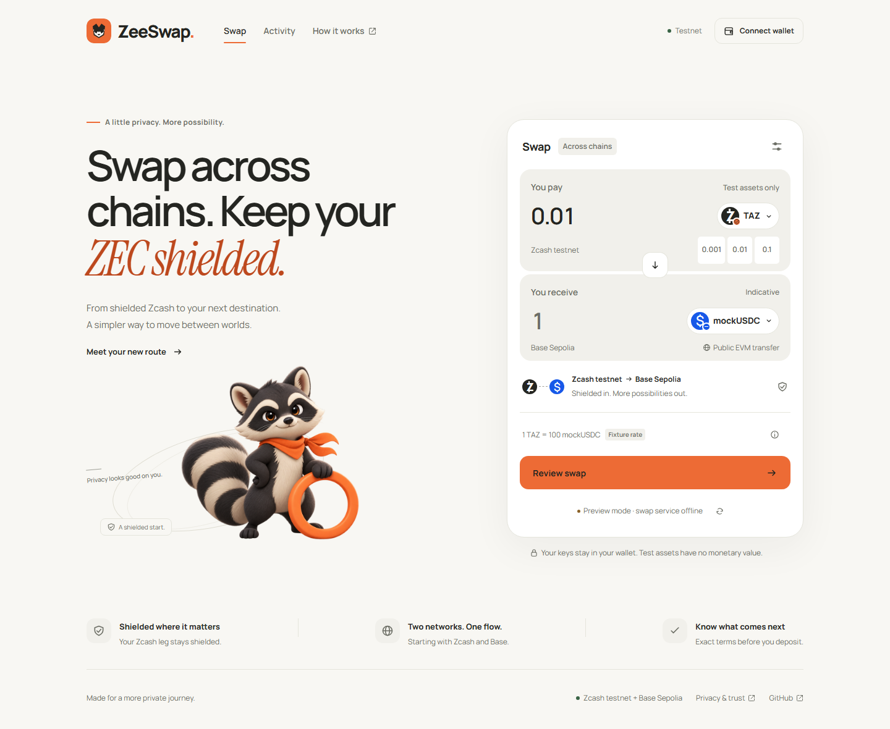

# ZeeSwap
**Swap across chains. Keep your ZEC shielded.**

ZeeSwap is building bidirectional swaps, constrained intents and a backed-token bridge between shielded Zcash and Base. The first swap pair is ZEC / USDC; the prototype uses TAZ on Zcash testnet and a project-issued USDC test token on Base Sepolia. The token and settlement contracts are deployed and source-verified.

Real testnet swaps are verified in both directions: **0.001 shielded TAZ → 0.1 USDC** and **0.1 USDC → 0.001 shielded TAZ**. After the initial G4 experiments, the first same-user circle also passed: both orders SETTLED, original receipts verified, exact final user balances and a reconciled twelve-wallet checkpoint. These use bounded operator harnesses and fixture pricing. The full product remains under construction.

The [public testnet interface](https://zeeswap.endpx.cloud/) and its HTTPS API are
deployed on an isolated VPS. The [web application](apps/web/README.md) provides a
responsive swap interface, wallet connection, private order activity and local
Zcash payment QR generation. Trading remains paused while the new Chef/Envio
sources complete catch-up and acceptance checks. The separate
[Linux deployment evidence](docs/evidence/native-linux-live-checkpoint.md)
distinguishes live frontend/API access from the still-open funded-circle gate.
Browser unit tests use synthetic responses; the screenshot below remains the
earlier offline preview, not a new cross-chain settlement.



The public interface also includes a separate **Bridge** mode for shielded TAZ
and **zeeTAZ**, the planned 8-decimal Base Sepolia representation with exact 1:1
principal. The paused contract, isolated encrypted accounting, private API flow
and web implementation have local and isolated PostgreSQL evidence. The
[actual public Bridge screen](docs/evidence/g6-bridge-web-live.md) explicitly
disables new deposits and burns: deployed bridge identity, dedicated backing,
concrete chain/wallet adapters and live two-way settlement remain acceptance
gates. A published interface is not a working live bridge. See the
[bridge design and integration contract](docs/bridge.md).

Swap pricing uses the fixed testnet rate **1 TAZ = 100 USDC** in both
directions, with zero protocol fee. New quotes do not require an exchange
price feed or a market-reference panel. Quote acceptance still locks the exact
output and reserves destination inventory. Chain fees and their operator
reserves remain separate. USDC is ZeeSwap's project-issued Base Sepolia test
token. Source recovery, capital checks and confirmed destination receipts
remain necessary before trading is enabled.

The navbar **Faucet** opens USDC, TAZ and Base Sepolia ETH funding options.
TAZ/ETH use explicit external faucet links. The dedicated USDC faucet is
deployed, source-verified and funded from a separate finite pool. It gives
10 USDC per wallet every 24 hours; an actual test claim passed. See
[deployment and claim evidence](docs/evidence/usdc-faucet-live.md) and the
[public interface verification](docs/evidence/fixed-rate-faucet-live.md).

```sh
pnpm install --frozen-lockfile
pnpm web:dev
```

See the web README for API origin/CORS configuration, production build, privacy
settings and verification commands. The separate [integration implementation](docs/evidence/integration-implementation-local.md)
includes prepared [Chef](indexers/zeer/README.md) and [Envio](indexers/envio/README.md)
projects, route accounting, isolated PostgreSQL persistence and the undeployed
V2 recovery contract. Their live activation gates remain explicit.

- [Implementation plan](plan.md): scope, decisions and acceptance gates.
- [Zcash wallet tooling](workers/zcash-wallet/README.md) and [live G1 evidence](docs/evidence/g1-feasibility.md).
- [Database module](api/README.md) and [live Neon evidence](docs/evidence/g2-database.md): encrypted quotes, guarded order/deposit transitions, reservations, balanced journals and fenced jobs.
- [HTTP API and observer](docs/api.md) and [real incoming-payment evidence](docs/evidence/g2-api-scanner.md): one shielded deposit advances one private order to READY without a destination payout.
- [Submission readiness](docs/submission-readiness.md): evidence available to reviewers and the remaining demo requirements.
- [Explorer verification](docs/evidence/explorer-verification.md): confirmed transaction and explanation of the stale explorer link.
- [Foundry contracts](contracts/README.md), [deployment registry](contracts/deployments/base-sepolia.json) and [G3 evidence](docs/evidence/g3-contracts.md): tested, deployed and source-verified USDC and Base settlement.
- [Forward backend integration](docs/base-integration.md) and [integration evidence](docs/evidence/g3-base-integration.md): private API, durable Base signer, finalized receipt observer and accounting tested through settlement on Anvil + Neon; live Base Sepolia connection checks passed without a payment.
- [Forward public-testnet settlement](docs/evidence/g4-live-forward.md): source and destination receipts, exact recipient delta, fees, ledger reconciliation and remaining gates.
- [Reverse public-testnet settlement](docs/evidence/g4-live-reverse.md): finalized escrow and acknowledgement, independent shielded recipient receipt, original-transaction recovery and complete accounting.
- [Reverse integration](docs/reverse-integration.md): escrow authorization and finalized commitment checks; the public reverse quote route remains closed while the guarded operator flow is validated.
- [Durable reverse adapter and repeatable tests](docs/evidence/g4-reverse-recovery.md): compiled SDK raw export, same-transaction recovery, guarded broadcast and independent receipt checks; local verification is distinguished from public-testnet payment evidence.
- [Worker interruption recovery](docs/evidence/g5-worker-interruption.md): a real worker process is killed after an Anvil PAY broadcast; fresh connections reconcile the original payment once with exact accounting. Broader recovery and the public-testnet soak remain open.
- [Old database snapshot recovery](docs/evidence/g5-snapshot-restore.md): actual PostgreSQL dump/restore, atomic paused startup and reconstruction from the independent original signing journal; five local fault/recovery cases passed.
- [Bounded soak runner and funded capital](docs/evidence/g5-soak-runner.md): reviewed twenty-order manifest, ten independently verified capital wallets and idempotent opening ledger; public-testnet soak not yet completed.
- [Reverse snapshot recovery](docs/evidence/g5-reverse-snapshot-restore.md): actual PostgreSQL rollback and original journal reconstruction on Anvil with a synthetic Zcash verifier. The separate [funded adapter interruption](docs/evidence/g5-funded-sdk-fault.md) subsequently recovered and settled the original R4 transaction on testnet.
- [Source refund boundaries](docs/evidence/g5-source-refunds.md): permanent cancellation and uncommitted escrow deadline gates, durable source refunds and full-principal accounting; live receipts are recorded separately below.
- [Actual funded refund experiments](docs/evidence/g5-live-refund-experiments.md) and [retry preparation](docs/evidence/g5-retry-preparation.md): both full-principal refunds are finalized, the historical run remains frozen and its capital allocation was released.
- [First same-user roundtrip](docs/evidence/g5-first-roundtrip.md): shielded TAZ to USDC and back to the original wallet; two SETTLED orders, finalized original receipts, zero open obligations/reservations, balanced books and twelve-wallet reconciliation. That two-order circle remains preserved; the current retry has advanced to 5/20 ordinarily receipt-verified settlements, with the first of four five-order barriers complete.
- [Actual F3 recovery](docs/evidence/g5-f3-scanner-recovery.md) and [read-only scanner error boundaries](docs/evidence/g5-read-only-scanner-errors.md): the third original forward payment finalized, exact twelve-wallet/books reconciliation passed at epoch 6, and its ordinary receipt verifier passed by 15:52 UTC. A later fourth-slot quote-step stop passed a separate [bounded no-effect reconciliation](docs/evidence/g5-r4-empty-quote-recovery.md) at 16:10:43 UTC: no quote or financial effect, database/main state unchanged and only the local controller latch cleared. The next normal driver accepted the R4 quote at 16:18:04 UTC (AWAITING_FUNDS), then returned a normal observer wait at FUNDING_CALL with controller incident false. The original R4 source fund subsequently finalized and passed exact HELD/READY recovery at epoch 6. A separate pre-COMMIT configuration-read timeout passed its scoped controller-only recovery; the original COMMIT was then signed and broadcast. Root verified its canonical successful receipt at 17:17 UTC, with Base finality still pending. R4 subsequently completed the funded SDK recovery, original delivery and SETTLE; its ordinary receipt verification passed at 18:54:42 UTC, bringing progress to four verified settlements. The first five-order barrier subsequently passed; at that checkpoint fifteen further settlements and three barriers remained pending. The original scanner failure cause remains unknown.
- [Observer reliability](docs/evidence/g5-observer-frontiers.md), [bounded live controller](docs/evidence/g5-live-controller.md) and [funded SDK recovery](docs/evidence/g5-funded-sdk-fault.md): actual scan/network-tip separation, epoch-fenced confirmations, once-only source actors and reviewed original-byte recovery. The R4 experiment reached economic closure; the remaining settlements and broader G5 failure matrix remain open.
- [Source-7 unfunded-attempt lifecycle](docs/evidence/g5-source7-unfunded-recovery.md): actual no-send audit and bounded expiry/archive passed with the old accepted attempt retained. Its distinct successor was later accepted and funded; every scan continues to monitor the old receiver and reference. The separate [source13 lifecycle](docs/evidence/g5-source13-unfunded-recovery.md) subsequently retained a second audited unfunded predecessor; the [split admission path](docs/evidence/g5-source-admission.md) preserves the original cutoffs and funding margins.

Current bounded-run status (2026-10-16 07:24:00.392 UTC / 14:24:00.392 WIB): **12/20 SQL SETTLED, 11/20 ordinarily receipt-verified, barriers [5,10]**. Root's literal Source15 no-effect expiry passed; its durable intent is COMPLETE, and the independent postcheck preserved all fourteen funded originals while retaining the third EXPIRED_UNFUNDED predecessor. Seventeen accepted attempts now comprise fourteen current funded IDs plus archives [7,13,15]; fifty-one reservations remain, six held, with two HELD obligations, fourteen operations and zero active leases. Two historical expired LEASED job records remain unchanged. Source15 attempt2 is SYNC and unaccepted: no successor quote or funding occurred. R12's original shielded delivery is independently confirmed physically but remains SQL-unconfirmed with no ACK; R14 COMMIT remains SQL-unconfirmed. All original financial bytes (67 operator/eight payer non-lock files, plus exact empty locks giving68/9 entries) are unchanged. Controls intake/dispatch/reconciliation and both incidents are false at epoch11; normal status passed at07:24 UTC. The COMPLETE intent file's modification time is07:23:48.4875078 UTC, distinct from currentProof07:23:42.136 and the independent postcheck time. The first recovery refused before expiry on a nullable SQL-anchor assembly error; root proved unchanged books, then the narrow canonical-floor correction and fresh retry passed. Completed-book Base fees remain **42002560003846 wei**, a partial total. Eight SQL settlements, nine ordinary verifications, barriers15/20, close and broader G5 gates remain pending. The exact closing profile is now **20 funded settlements,23 accepted attempts and69 released reservations**, with all three retired receiver/reference pairs monitored. Primary intake and dispatch remain disabled; driver held for grouped publication. See [Source15 lifecycle](docs/evidence/g5-source15-unfunded-recovery.md), [scanner catchup](docs/evidence/g5-source-scan-catchup.md), and [prior original-PAY28 recovery](docs/evidence/g5-f11-prestore-recovery.md).

Root's fixed no-send source-7 audit subsequently passed at 19:48 UTC: the original 110000-zatoshi input remained spendable, with zero SDK calculations and no intent/result. The actual scan reached 4505860 against tip 4505862 and unchanged cutoff 4505813; the raw source-view check retained the prior three notes and zero pending notes. At that checkpoint this was read-only evidence, with no SQL expiry, archive, successor payment or controller resume. The subsequent actual expiry/archive result is recorded above.

Root's actual archived-source watcher passed at 20:12:08.082 UTC: scan 4505915, three existing outputs, no old deposit/obligation, old order EXPIRED_UNFUNDED, reconciliation false at epoch 8 and settlements/barriers unchanged at five/[5]. Its eligibleOperations=3 is an idempotent existing-operation count, not new work. No successor quote/funding or driver resume occurred at that checkpoint. The grouped repair/expiry/watcher milestone was subsequently published as 1b6fea5d54dd2c66623a6be7a899203e42a27a13, with its remote SHA verified at 20:18 UTC; the resumed run later reached the separate F7 incident and bounded recovery above.

## Verify locally

With Node 24 and pnpm 10.21.0, these checks require no wallet or database credentials:

Run the Python wallet suite on Linux/WSL; the signer recovery tests exercise Linux
file locking and directory fsync.

```sh
pnpm install --frozen-lockfile
pnpm typecheck
pnpm test
python -m unittest discover -s workers/zcash-wallet -p 'test_*.py'
```

`pnpm test:integration` requires private operator configuration and uses the isolated regression branch. These deployment scripts deliberately allowlist the project's Neon endpoints; a fresh clone cannot access them without credentials. See [database setup and test isolation](api/README.md). `pnpm api:start` also requires private runtime and wallet configuration; primary funding routes remain gated.

## Privacy and trust

The operator can decrypt payments addressed to its shielded receiver and holds settlement inventory. This prototype uses a custodial operator model. Base transfers are public, and the operator can associate both sides of an order. The shielded claim applies to the Zcash leg; it does not promise end-to-end anonymity, atomic settlement or trustless custody.

The frontend and API are publicly reachable; unattended public cross-chain payout
operation is not established. Initial swaps in each direction and the historical
first same-user roundtrip passed. The new VPS source-freshness and funded-circle
gates, remaining recovery/soak, end-user wallet acceptance and the bridge remain
open. Intake and financial dispatch remain disabled. Contract tests require
`git submodule update --init --recursive`; see the Foundry module guide.
