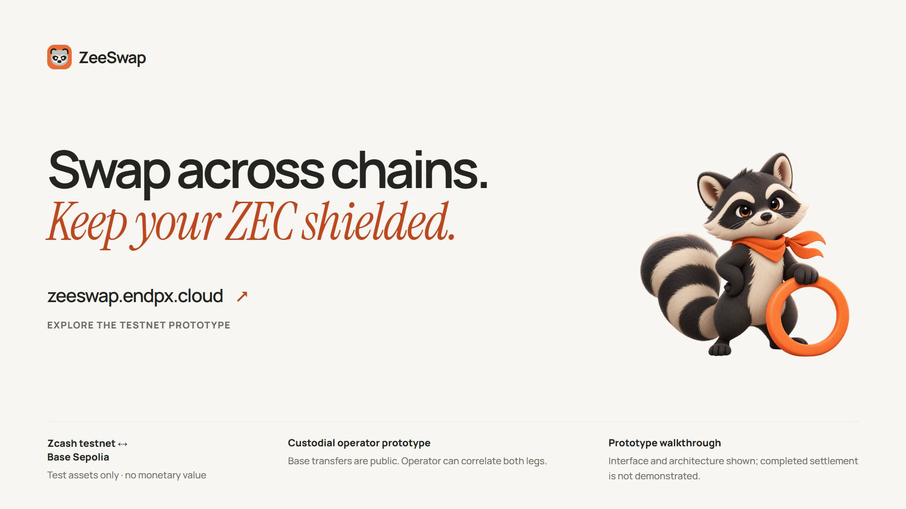
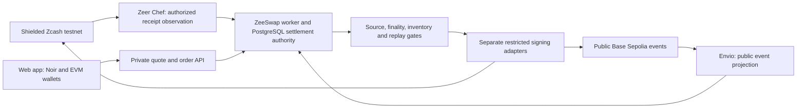

# ZeeSwap

**Swap across chains. Keep your ZEC shielded.**

ZeeSwap connects shielded Zcash with Base through a two-way swap interface and a
separate backed-token bridge design. It is built for users who want to move
between a shielded Zcash wallet and Base without publishing their Zcash receiver
in Base calldata. The testnet prototype uses **TAZ ↔ USDC** for swaps and
**TAZ ↔ zeeTAZ** for the bridge.

[Explore the testnet](https://zeeswap.endpx.cloud/) · [Watch the film](https://youtu.be/tqusmo-u0Pc) · [Judge guide](docs/judge-guide.md) · [Current readiness](docs/submission-readiness.md) · [Evidence](docs/evidence-index.md)

> **Testnet prototype.** The interface is public; transaction availability is
> controlled by independent backend gates. Read the [current status](docs/submission-readiness.md)
> before trying a transaction. Historical settlements prove bounded experiments,
> not an always-on public service. All depicted tokens are test assets.

[](https://youtu.be/tqusmo-u0Pc)

*Actual frame from the 80-second product film. [Download the MP4](https://github.com/EndPx/ZeeSwap/releases/download/demo-2026-10-29/zeeswap-original-logos.mp4).
UI and wallet actions are illustrations; the film does not record a fresh settlement.*

## Why ZeeSwap

Moving value between shielded Zcash and an EVM chain brings two different
visibility models into one journey. A useful application must explain where
privacy ends, match the exact deposit to its order, and recover uncertain
payments without sending twice.

ZeeSwap makes those boundaries part of the product:

- **One explicit journey:** connect Noir for Zcash testnet and an injected EVM
  wallet for Base Sepolia, review exact terms, then approve funding separately.
- **Two distinct products:** swap TAZ and project-issued USDC at the fixed
  testnet rate **1 TAZ = 100 USDC**, or use the separate 1:1 TAZ/zeeTAZ bridge
  flow when its own backing and availability gates are qualified.
- **Receipt-led settlement:** authorized shielded receipts and public Base
  events feed one settlement authority with exact integer accounting, reserved
  inventory and original-transaction recovery.

The protocol fee is zero in the testnet swap policy; network fees remain
separate. USDC is the display label for ZeeSwap's project-issued Base Sepolia
test token, not Circle-issued USDC. zeeTAZ is a separate eight-decimal
representation of TAZ, not the swap's USDC output.

## The user journey

1. Select Swap or Bridge and the desired direction.
2. Connect the wallet for each leg. Connecting does not send a payment.
3. Check service availability, destination and exact amount before accepting.
4. Approve the accepted funding instruction in the appropriate wallet.
5. Follow the private order as source verification and destination delivery
   advance independently. An uncertain payment stays pending reconciliation.

New quotes and deposits remain disabled whenever the required service gates are
closed. The [judge guide](docs/judge-guide.md) explains what can be reviewed
without funding a transaction.

## How it works



This is the system architecture. Component deployment and freshness are recorded
separately in [current readiness](docs/submission-readiness.md). Indexers observe;
they do not authorize payouts. See [architecture and trust](docs/architecture.md).

## What the evidence establishes

Historical operator experiments completed a shielded TAZ → USDC swap, a USDC →
shielded TAZ swap, a same-user roundtrip and both full-principal source refunds.
The reports preserve original receipts, recipient deltas and ledger checks.
The larger G5 soak was stopped before completion. Its partial results are
retained with their original limits in the [evidence index](docs/evidence-index.md).

The motion demo is an **illustrated walkthrough**, with simulated UI and wallet
steps. Its [published film](https://youtu.be/tqusmo-u0Pc)
and [source/provenance](tools/demo-video/PROVENANCE.md) are public. It does not
depict a freshly completed transaction.

## Run the interface locally

Requires Node.js 24 and pnpm 10.21.0. From a fresh clone:

```sh
git clone https://github.com/EndPx/ZeeSwap.git
cd ZeeSwap
pnpm install --frozen-lockfile
pnpm web:dev
```

Open `http://127.0.0.1:5173`. The UI can be explored without a running API;
offline arithmetic is labelled a preview and creates no quote or order.
[Web configuration](apps/web/README.md) documents `VITE_API_BASE_URL` and CORS.
Backend execution needs private operator configuration and remote PostgreSQL;
a source checkout does not include wallets, credentials or service admission.
The web preview requires neither Docker nor local PostgreSQL. Existing deployment
guides describe the remote Neon database and VPS runtime.

## Verify the source

These commands require no wallet or database credentials:

```sh
pnpm typecheck
pnpm test
pnpm test:integration:local
pnpm web:test
pnpm --filter @zeeswap/web typecheck
pnpm web:build
```

`pnpm test` runs the API unit entry point; it is not the entire repository's test
inventory. Run native wallet durability tests on Linux/WSL:

```sh
python -m unittest discover -s workers/zcash-wallet -p 'test_*.py'
```

For Solidity, install the [documented Foundry toolchain](contracts/README.md),
then initialize its pinned dependencies:

```sh
git submodule update --init --recursive
cd contracts
forge fmt --check
forge build --sizes
forge test -vv
```

Database/HTTP/settlement integration suites require isolated remote Neon
configuration. See the [API guide](api/README.md); never point fixture tests at
an active application database. The [evidence index](docs/evidence-index.md)
records performed checks separately from these reproducible commands.

## Repository map

| Module | Responsibility |
| --- | --- |
| [apps/web](apps/web/README.md) | React/Vite interface, Noir and EVM wallet flows, private order activity |
| [api](api/README.md) | Exact accounting, encrypted private data, admission, reconciliation and worker orchestration |
| [contracts](contracts/README.md) | Base settlement, test token, faucet and separate bridge contracts |
| [workers/zcash-wallet](workers/zcash-wallet/README.md) | Native Zcash wallet observation and durable signing boundary |
| [indexers/zeer](indexers/zeer/README.md) | Authorized watch-only Zcash receipt projection |
| [indexers/envio](indexers/envio/README.md) | Public Base event projection |
| [tools/demo-video](tools/demo-video/DESIGN.md) | Editable Remotion film and audio/asset provenance |
| [docs](docs/judge-guide.md) | Product review path, architecture, evidence and operational guides |
| [plan.md](plan.md) | Detailed product decisions and acceptance gates |

## Privacy and trust

ZeeSwap is an **operator-custodial prototype**. The operator controls settlement
and can correlate the two legs. Base transfers and contract events are public;
shielding applies to the Zcash leg. Contract acknowledgements are operator
attestations, not on-chain verification of Zcash consensus. Cross-chain delivery
has an explicit operator liveness dependency.

Credentials, wallet databases, viewing/spending keys, private capabilities, full
memos and private order mappings stay outside public Git. Public reports are
sanitized evidence, not access to the operator's financial systems.

The [submission checklist](docs/submission-readiness.md) owns current deployment,
video, license and remaining acceptance status. The previous front page is
preserved byte-for-byte as [historical documentation](docs/history/legacy-readme-20261029.txt).

## License and asset terms

Project code is available under the [MIT License](LICENSE), copyright 2026
ZeeSwap contributors. Third-party dependencies, fonts, logos and other assets
retain their respective licenses and trademark rights; the project MIT license
does not relicense them. See the [web artwork sources](apps/web/public/brand/README.md),
[film brand sources](tools/demo-video/public/brand/README.md),
[Envio asset license](tools/demo-video/public/brand/ENVIO-LICENSE.txt),
[Manrope OFL](tools/demo-video/public/fonts/manrope-OFL.txt) and
[Instrument Serif OFL](tools/demo-video/public/fonts/instrument-serif-OFL.txt).
