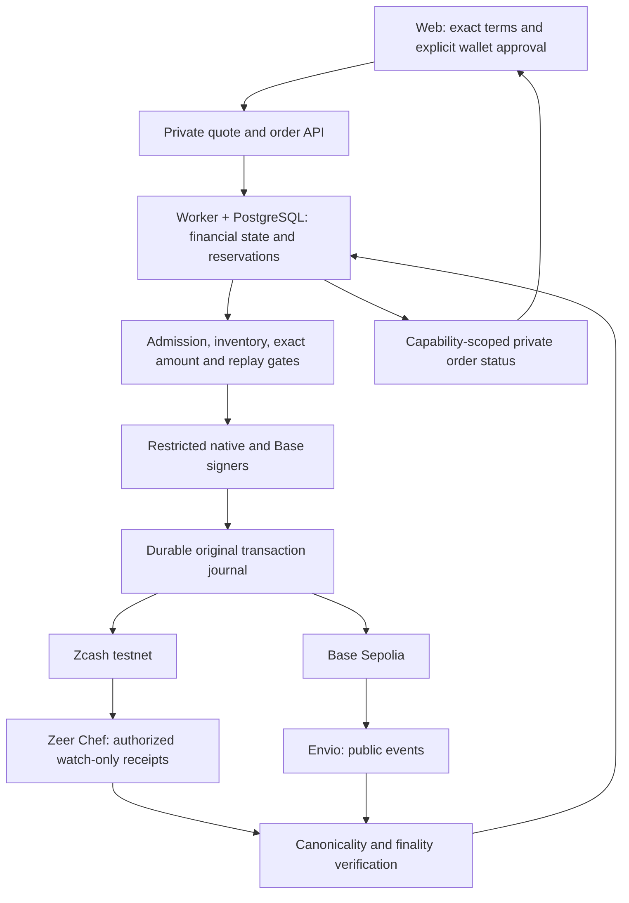

# Architecture and trust boundaries

ZeeSwap combines private Zcash receipt observation, public Base observations and
one off-chain financial authority. Its swap and backed-token bridge paths share
engineering principles but have distinct books, assets and activation gates.
This page describes responsibility; [readiness](submission-readiness.md) records
which parts are qualified on the active deployment.

## Data and execution flow

The diagram does not imply every arrow is currently active. Indexer liveness,
canonical history, admission and financial execution must each be qualified.

## Ownership

| Boundary | Owns | Does not establish |
| --- | --- | --- |
| [Web](../apps/web/README.md) | Displayed terms, wallet requests and private order capabilities | Source finality, backing or destination delivery |
| [Zeer Chef project](../indexers/zeer/README.md) | Authorized shielded receipt projection | Spend authority or payout permission |
| [Envio project](../indexers/envio/README.md) | Public Base event projection | Shielded memo access or financial authorization |
| [API and PostgreSQL](../api/README.md) | Accepted liabilities, reserved inventory, balanced journals, state and reconciliation | A destination receipt merely from an internal status label |
| [Native wallet worker](../workers/zcash-wallet/README.md) | Explicit wallet-bound observation/signing operations | Permission to retry an uncertain transaction with new bytes |
| [Base contracts](../contracts/README.md) | Role-controlled escrow, payout/cancellation and token rules | Verification of shielded Zcash consensus |
| [Bridge service](bridge.md) | Isolated TAZ/zeeTAZ book and backing/replay rules | A working bridge merely because contracts or UI exist |

## Swap accounting

The current testnet rule is 1 TAZ = 100 project-issued USDC. TAZ has eight
decimals and the USDC test token has six: one zatoshi maps to one USDC micro-unit.
Amounts remain canonical integer strings or bigint throughout accounting.
Network fees and their reserves are separate from principal and protocol fees.
Historical accepted quotes retain their original terms.

Forward settlement verifies a shielded receipt before preparing the reserved
Base payout. Reverse settlement verifies the Base escrow/commitment before
preparing the shielded destination payment. Source observation and destination
delivery have different states and independently verified receipts.

An ambiguous signing/broadcast result preserves the original operation and its
liability. Reconciliation checks that original operation before another action.
Permanent cancellation and eligible source-refund paths have their own gates;
pausing does not magically close an already accepted obligation.

## Bridge accounting

TAZ ↔ zeeTAZ is a separate 1:1 principal representation, with eight decimals on
both sides. It does not exchange TAZ for USDC. The bridge requires dedicated
backing, exact contract identity, canonical source/burn proof, fee capacity and
qualified mint/redemption adapters. Swap receipts do not prove bridge solvency.
See [bridge design](bridge.md) for state and cancellation rules; its dated
implementation checkpoints should be read with [current readiness](submission-readiness.md).

## Privacy and custody

Shielded addresses and memos are private application inputs. Authorized viewing
material lets the operator observe the Zcash leg; public transaction identifiers
alone do not decrypt shielded memos. Base recipients, amounts and events remain
public. The operator can correlate both legs and controls custody/settlement.

Base contract acknowledgements attest the operator's off-chain decision. The
system does not prove Zcash consensus on Base and does not promise atomic
cross-chain delivery. The current contract's committed escrow can remain locked
if the operator cannot finish the shielded payout; the
[contract guide](../contracts/README.md) documents this liveness limitation.

Sensitive configuration, keys, wallet stores, full receipts/memos and private
order mappings remain outside Git. Public sanitized evidence is deliberately
separate from live financial authority and private operator recovery material.
