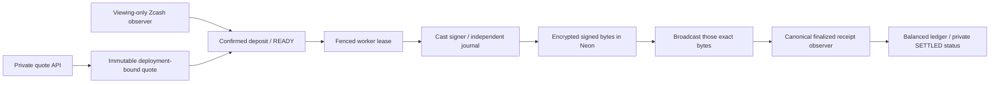

# Forward settlement integration

The implemented execution path is **shielded TAZ intake → Base mockUSDC payout**.
It joins the existing quote API and Zcash observer to the deployed Base contract,
a restricted `cast` signer, durable signed attempts and finalized receipt accounting.
The reverse HTTP route remains gated until a Zcash payout signer and its recovery
flow are integrated. The Base contract alone does not make that route operational.
The [reverse integration guide](reverse-integration.md) tracks escrow and
commitment preparation separately from completed payment evidence.

## Flow and persistence



Migration 0009 introduces `execution_mode` and `base_contract` on immutable
quotes. Existing quotes default to `observe-only` and cannot enter the new
dispatcher, including the earlier real TAZ intake using fixture inventory and
a placeholder Base recipient.

`base_bindings` pins private payout terms once. The public Base ID is derived
from the quote's separate random settlement UUID; it is not the order-access
token, memo reference or Zcash transaction ID. `base_attempts` persists encrypted
signed transaction bytes and HMAC transaction identities before broadcast, with
one immutable attempt for each order/phase. Authorization and raw transactions
are also persisted in the signer's independent owner-only journal.

Each worker step uses a fenced lease and fresh canonical source observations.
It first reserves the destination amount on Base, waits for the reservation to
finalize, then prepares the payment. A recorded uncertain transaction is looked
up and reconciled; if absent, only its original bytes may be rebroadcast. A nonce
conflict, expired authorization, changed receipt, reorg or unexpected fee stops
the CLI and enters reconciliation mode. There is no automatic fee bump or new
nonce replacement.

Receipt acceptance matches chain, sender, destination contract, canonical block,
finalized height, event type, settlement ID, recipient and amount. The SQL boundary
also requires a fresh finalized canonical checkpoint. `SETTLED` is only reached
after a matching finalized `Paid` receipt. Inclusion and mempool acceptance are
insufficient. The private API exposes the final Base receipt only after checking
the caller's order capability; there is no public order-to-two-chain listing.

Settlement consumes reserved mockUSDC and actual Base gas, releases unused fee
reserves, discharges the source obligation and balances ledger entries per asset.
Received TAZ proceeds move to an unreconciled operator bucket; they are not
automatically credited as spendable inventory. A customer source reorg still
requires incident reconciliation even if the destination payment already happened.

## Operator commands

```sh
# Read-only deployed-chain identity, bytecode, role and inventory checks:
pnpm base:preflight

# Local API with real deployment checks, using the development configuration:
pnpm --filter @zeeswap/api exec tsx scripts/serve.ts --integration --base

# Refresh both chain observers and attempt one eligible forward step:
pnpm --filter @zeeswap/api exec tsx scripts/base-dispatch.ts --integration

# Observe already-recorded receipts without signing/broadcasting:
pnpm --filter @zeeswap/api exec tsx scripts/base-dispatch.ts --integration --reconcile-only
```

These commands require the existing private database/wallet configuration.
`ZEE_BASE_SIGNER_CLIENT` selects a private JSON file, defaulting to
`.deploy-local/base-signer-client.json`, with `command` and a fixed `args` array.
It launches `workers/base-signer/signer.py --config PRIVATE_SIGNER_CONFIG` using
the configured Linux/WSL Python. These are server settings, never HTTP inputs.

The admin-only `scripts/configure-base.ts` first verifies the deployment, then
copies the canonical mock address into the database asset row. `--production`
selects the known primary. It does not enable intake/dispatch or credit inventory.
The primary remains paused. Real orders also need reconciled capital, operator
gas and the explicit primary Zcash wallet configuration.

Starting a process with `--base` does not open the primary's funding routes.
The API rejects empty on-chain inventory or insufficient operator gas before
creating a new executable quote. Fixture balances in Neon cannot override this.

## Reproduce the integration test

Build the Foundry artifacts first. Start an isolated Anvil process:

```sh
anvil --host 127.0.0.1 --port 18745 --chain-id 84532 --base-fee 0 --gas-price 1000000 --silent
```

Then run `pnpm test:settlement`. The runner requires the dedicated
`zeeswap-g3-settlement-tests` branch (`br-wispy-dawn-aorsbba5`), with private
`neon-settlement-tests.json` and `neon-settlement-tests-runtime.json` configuration.
It refuses the primary and real-evidence branch. The suite deploys local contracts,
uses synthetic shielded inputs and loopback-only EVM transactions, preserves
synthetic history, zeros unreserved fixture inventory and leaves the branch paused.
It cannot be pointed at a public RPC through the test configuration.

The historical reverse preflight fixture retains its pending escrow and
reservations. The runner now creates a separate disposable database for each
suite invocation and removes only that invocation-owned database after testing.
It never resets historical `neondb`. See the
[repeatable fixture lifecycle](evidence/g4-reverse-recovery.md#repeatable-fixture-lifecycle)
for role-bootstrap checksums and cleanup behavior.

Read [the evidence record](evidence/g3-base-integration.md) for the exact boundaries
between the Anvil settlement proof and the live Base Sepolia connection checks.

## Bounded public-testnet operator harness

`api/scripts/live-forward.ts` manages one private forward experiment on its
dedicated live branch. `workers/zcash-wallet/forward_send_once.py` supplies the
bounded one-time source send and read-only fee-capital check. See
[G4 preparation](evidence/g4-forward-preflight.md) for the sequence and recovery
limits. Migration 0010 renews a live worker fence while signing/scanning proceeds;
observer freshness is checked again before transaction persistence and broadcast.

The first bounded run completed on public testnets; see [G4 receipts and
reconciliation](evidence/g4-live-forward.md). With the existing private experiment
configuration, `pnpm --filter @zeeswap/api exec tsx scripts/verify-live-forward.ts`
checks final receipts, the recipient balance delta and ledger conservation without
signing, broadcasting, running the observer or changing runtime controls.
