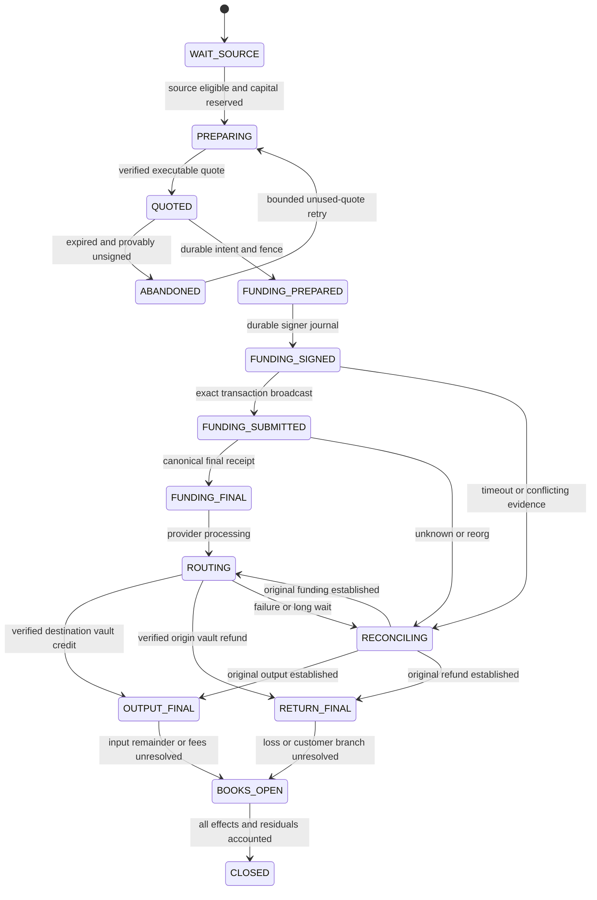

# EVM route recovery and accounting

Specification v1, 23 October 2026. Applies to the proposed disabled
`evm-treasury-route-v1` mode. Existing direct settlement and accepted orders keep
their original policies. Read the [quote policy](near-evm-quote-policy.md) and
[observation contract](observation-adapters.md) first.

## Three independent outcomes

| State machine | Question it answers | Completion evidence |
| --- | --- | --- |
| Provider route | Where did the operator's EVM input go? | Canonical funding, treasury output, refund and cost/exposure reconciliation. |
| Customer obligation | Did this customer receive the agreed output or source refund? | Final delivery/refund to the immutable recipient plus mutually exclusive branch proof. |
| Financial reconciliation | Are capital, liabilities, reservations, fees and journals consistent? | Per-asset conservation, unique receipt allocations, no unexplained differences. |

Customer settlement can finish while a provider's unused-input refund remains a
treasury receivable/exposure. A safe customer refund can finish while an uncertain
provider route remains an operator incident. Neither circumstance releases the
operator's remaining exposure hold. An order must not erase a separate second
deposit, provider fee discrepancy or source-reorg liability.

## Proposed records and constraints

Reuse existing tables where their semantics fit; actual names/migrations require
a bounded implementation review. These are logical records, not applied SQL.

| Record | Required immutable data and mutable progress |
| --- | --- |
| Route plan | Order/private accepted digest, route mode, approved provider, exact asset registry identities, source/destination/refund vaults, required treasury output, input/gas caps, loss/exposure hold. |
| Route attempt | Parent plan, monotonically assigned attempt number, request digest, encrypted verified response, provider locator, quote signature/times, exact funding instruction; status history. |
| Route operation | Stable operation ID, chain/account/nonce, token/value/calldata digest, fee cap, signer journal identity, signed tx hash/recoverable bytes, fence, submission/inclusion/finality evidence. |
| Receipt allocation | Network, tx hash, log/native receipt position, block occurrence, asset, vault, integer units, allocation to one economic effect. |
| Customer obligation | Primary deposit identity, source principal, exact output or refund branch, immutable recipients, terminal proof, residual/exception obligations. |
| Recovery case | Trigger, original identities, exclusions already proved, unresolved facts, capital holds, operator decisions and appended evidence digests. |

Unique constraints cover economic deposit identity; order + operation kind;
route attempt funding operation; chain + account + nonce ownership; canonical
receipt economic allocation; settlement ID + terminal branch. Re-inclusion changes
the occurrence record, not nonce ownership or economic allocation. Conflicting
claims block reconciliation instead of overwriting earlier evidence.

Use two capability boundaries: the provider treasury signer can only send the
reserved provider input to the verified deposit destination; the customer
settlement signer can only execute/cancel the immutable customer authorization.
Use separate accounts/nonce queues where necessary so a stuck provider transfer
cannot prevent customer cancellation. No process accepts generic calldata or
uses a provider response as unrestricted signing authority.

## Provider route progression

These are proposed internal route states, separate from existing order states.

`OUTPUT_FINAL` and `RETURN_FINAL` are facts, not necessarily mutually exclusive:
EXACT_OUTPUT may return unused input after delivering output. Store independent
funding/output/refund receipt sets and totals; the diagram shows primary progress
only. `CLOSED` requires complete allocation or explicit funded loss recognition,
not simply a provider terminal string. Reopen an incident if later contradictory
facts arrive; never edit away settled customer history.

## Provider status mapping

Poll the documented operation locator: deposit address, plus memo if the quote
supplies one. Persist all observed transitions; unknown status values block the
adapter rather than falling back to success/failure. HTTP 404, transport timeout
or stale `updatedAt` is not a chain fact.

| Provider status | Normalized interpretation | Allowed action |
| --- | --- | --- |
| `PENDING_DEPOSIT` | Provider has not recognized sufficient funding. | If provably unsigned, abandon within quote rules; if any signature exists, reconcile original payment. Never fund a second attempt. |
| `KNOWN_DEPOSIT_TX` | Provider has a candidate funding transaction. | Check its chain/account/token/value and canonical receipt; no customer payout yet. |
| `INCOMPLETE_DEPOSIT` | Provider considers funding insufficient/incomplete. | Reconcile exact sent/received input; no automatic top-up. Wait for return or use guarded customer cancellation. |
| `PROCESSING` | Provider operation in progress. | Continue bounded polling and chain checks; keep exposure reserved. |
| `SUCCESS` | Provider reports completion. | Verify actual final treasury output, exact asset/vault/net amount and unique allocation before customer delivery eligibility. |
| `REFUNDED` | Provider reports input returned. | Verify actual finalized origin-vault receipt and amount. Reconcile provider fees/loss separately; evaluate customer refund guards. |
| `FAILED` | Provider reports failure; money disposition is not established. | Reconciliation/incident. Do not assume returned funds or safe retry. |

Provider response signatures, where supported, authenticate payloads; they do not
replace chain verification. Output/refund transaction references must be bound to
the stored locator through the documented authenticated provider response. Then
independently validate actual canonical chain receipts, exact token emitter,
destination vault, amount and unique event allocation. Unattributed balance
increases, the same transfer claimed by two attempts, or ambiguous batch
withdrawals are quarantined. A preview's `amountOut` is never a received balance.

The first mode uses allowlisted standard ERC-20 transfers. Native transfers and
trace-only deliveries stay disabled until a separate receipt/tracing contract is
specified. Multiple refund/withdrawal receipts must be retained and summed only
after proving their unique attribution; a later partial receipt cannot overwrite
the first. Finalized output below the required amount is an incident, not permission
to lower the customer's output. Extra output is operator treasury inventory under
the fixed-output agreement; it cannot be reused until reconciliation allocates it.

## Customer branch and refund authority

For a Zcash-source order, customer delivery is the final ZeeSwap EVM payout, not
the provider's transfer to the operator vault. The destination settlement
contract must enforce one public ID with irreversible `PAID` versus `CANCELLED`
outcomes. Cancellation includes unused IDs; no still-valid authorization can
revive a cancelled one. Rejecting one failed transaction is not cancellation.

For an EVM-source order, source escrow enforces `FUNDED -> PAYOUT_COMMITTED ->
SETTLED`, or `FUNDED -> REFUNDED` at/after the immutable cancellation time. The
worker must wait for finalized commitment and re-read the committed state before
Zcash signing. A competing refund wins or loses onchain, not in an API race.

| Case | Guard before customer source refund |
| --- | --- |
| Zcash source, no customer payout signed | Finalized destination `CANCELLED` tombstone, compatible latest state, reconciled journal/fence, confirmed source principal and safe refund fee capacity. |
| Zcash source, customer EVM payout signed/submitted/unknown | Reconcile every original attempt; finalize and re-read `CANCELLED`. If `PAID` exists, settle delivery and forbid principal refund. No RPC response is not cancellation. |
| Provider funding/output unknown, all provider endpoints operator-controlled | The same finalized customer-cancellation guard permits source refund while provider exposure remains reserved. A late provider credit cannot bypass the tombstone or pay the user directly. |
| EVM source, escrow still `FUNDED` | Source-chain contract refund only at/after cancellation eligibility; verify latest/finalized state. Do not pay from an unrelated treasury account and leave an additional escrow claim open. |
| EVM source, escrow `PAYOUT_COMMITTED`, no successful Zcash payment | Requires the guarded abort capability below; current contract does not provide it. Timeout alone cannot refund. |
| Customer payout already canonical/final | Acknowledge the original delivery and settle the obligation; source principal refund forbidden. Additional deposits are separate obligations. |
| Partial/ambiguous customer delivery | Reconciliation only. No automatic full source refund that could double compensate; make whole only through a separately recorded, bounded recovery decision. |

This design can return Zcash principal before NEAR returns USDC because the
provider is moving operator assets between operator vaults, and final customer
delivery has been permanently disabled. That is an explicit operator risk choice,
bounded by the entire funded route input cap. If vault ownership, immutable
provider recipient or cancellation proof is uncertain, this early-refund path is
disabled. It does not depend on proving that a provider will never send again.

Provider direct-to-user delivery is prohibited in this mode precisely because
`FAILED`/`REFUNDED` or a currently empty recipient balance cannot prove no later
customer delivery. It would require a different financial and cancellation model.

### Future reverse abort contract

The inspected `ZeeSwapSettlement.sol` has no transition from `PAYOUT_COMMITTED`
back to refund. The new provider mode must not promise automatic recovery there
until a new, separately reviewed contract implements these semantics:

The future source escrow also needs a safe refund executor: at/after the immutable
cancellation time, anyone may trigger the `FUNDED` refund, but only the signed
refund recipient receives exactly the escrow principal. This lets the operator
pay gas without changing the payer or opening an additional claim. The current
contract instead requires the payer caller; existing accepted orders keep that
rule. Do not claim unattended operator-paid refunds on the future path until
this new behavior is tested.

1. Bind an abort authorization to chain, contract, public settlement ID, exact
   escrow refund recipient, current mode, abort nonce and recovery-proof digest.
   Only a distinct recovery role can submit it. It cannot change the recipient.
2. Offchain recovery revokes the payout operation's signer fence and durably
   reconciles all independent journals/backups. Every signed Zcash transaction
   must either be canonically unsuccessful or expired beyond its consensus expiry
   height with the required canonical reconciliation depth. A dropped mempool
   entry does not establish this. Never abort when any alternative signed payload
   could still land or any delivery succeeded.
3. Onchain atomically move `PAYOUT_COMMITTED` to a terminal refund state and return
   exactly escrow principal; later `settleEscrow` and payout authorization for that
   ID fail. Emit a dedicated abort/refund event, not a false delivery event.
4. Verify canonical refund receipt and finalized terminal state, then acknowledge
   the customer refund. Never release source escrow to inventory on this branch.

The contract cannot verify shielded nonpayment by itself; it trusts the recovery
attestation. The operator could abuse that authority. This custody/trust limitation
must be disclosed and tested, not presented as a trustless timeout guarantee.
If this capability is deferred, reverse provider mode remains disabled; the
existing committed-state incident procedure is not upgraded by this document.

## Journal and crash-recovery protocol

1. In a short SQL transaction, lock obligation/reservations, validate current
   observer epoch and immutable terms, allocate operation ID and fenced outbox
   job, then commit. No provider/RPC call inside the transaction.
2. Restrict the signer by network, asset, exact destination/value, nonce ownership,
   operation digest, fee cap and fresh active fence. Durably write intent before
   proving/signing; persist chosen inputs or EVM nonce plus recoverable signed
   payload and hash before broadcast. Journal durability must survive SQL failure.
3. Submit the same signed transaction. SQL acknowledgement is an observation of
   that operation, not authorization to create another payment. Optional provider
   deposit-hash notification only speeds discovery; it is not payment proof.
4. If the response is lost, enter `RECONCILING`. Query original hash, sender/nonce,
   canonical receipts and signer journal. EVM transactions do not expire merely
   because an API quote deadline passed. A replacement, if ever supported, must
   belong to the same economic operation/nonce and approved bounded policy; v1
   does not construct a new transfer to a new quote.
5. On restart/DB restore, begin read-only reconciliation. A stale worker or restored
   job must fail signer fencing. Compare chain, independent journal, current
   branch and reservations before enabling any financial dispatch.

Once a provider funding signature exists, an order cannot acquire another funded
provider attempt in this version. Read retries, identical valid broadcast retries
and unused-quote retries are different operations from a fresh payment.

## Per-asset books

Maintain balances and liabilities separately for each network, contract/native
asset and vault. USDC on two chains is two custody locations with distinct risk;
ZEC and USDC never cancel each other numerically. Prices are separate valuation
metadata, not permission to equate atomic units.

| Account/control | Treatment |
| --- | --- |
| Segregated customer source principal | Liability-backed balance; unavailable to routes or other orders. |
| Operator available inventory | Confirmed controlled capital after holds. |
| Operator route reservation | Exclusive earmark up to input cap, also the capital exposed to total provider loss. Do not subtract the same hold twice under a second label. |
| Provider input in flight | Actual signed/funded operator spend; unavailable even when provider status is unknown. Unreceived refunds are not spendable inventory. |
| Provider output in transit | Unconfirmed/provisional value; never final payout capacity. |
| Confirmed provider output | Destination treasury capital, allocated once after canonical verification. |
| Provider refund receivable/exposure | Separate from cash until actually received; amount/fees may remain uncertain. |
| Customer payout/refund obligation | Cleared only by its own final receipt and branch proof. |
| Gas, provider fee and loss | Operator expense; actual units and asset recorded independently. |

On each vault/asset, journaled controlled balance reconciles to opening balance
plus verified incoming units minus verified outgoing units. Reservations change
available balance without creating money. A deficit blocks new intake/dispatch
for the affected capital pool; existing liabilities remain visible. Unknown
costs retain conservative holds until bounded loss is recognized or receipt
evidence resolves them. An operator loss never becomes an undisclosed deduction
from a customer's source principal.

### Concrete refund example

These are fictional integer fixtures, not live prices or receipts:

- User source deposit: 10,000,000 zatoshi = 0.1 testnet TAZ.
- Operator route funded: 9,980,000 origin USDC units = 9.98 USDC.
- Provider route fails; finalized refund received: 9,900,000 units = 9.9 USDC.
- Difference: 80,000 USDC units = 0.08 USDC, classified as verified fee/loss or
  retained exposure until its cause is established. Gas is a separate asset.
- No customer payout exists; destination cancellation tombstone is finalized.
  ZeeSwap returns 10,000,000 zatoshi to the agreed shielded refund receiver,
  paying the Zcash fee from operator fee capacity.

Illustrative per-asset journal entries (each row balances in one asset):

| Event | Debit | Credit |
| --- | --- | --- |
| Receive source | Segregated Zcash cash 10,000,000 | Customer source liability 10,000,000 |
| Fund provider | Route custody/exposure, origin USDC 9,980,000 | Operator origin USDC cash 9,980,000 |
| Receive provider return | Operator origin USDC cash 9,900,000 | Route custody/exposure 9,900,000 |
| Recognize verified unrecovered cost | Operator USDC fee/loss 80,000 | Route custody/exposure 80,000 |
| Return source principal | Customer source liability 10,000,000 | Segregated Zcash cash 10,000,000 |

If the missing 80,000 is not established as fee/loss, leave it as an impaired,
unavailable exposure under the recovery case; do not claim the books closed.
Later recovery reverses the impairment/classification appropriately. No USDC
refund amount is used to compute a reduced Zcash refund.

When customer delivery succeeds, discharge the source obligation and acquire
source inventory through a linked exchange-clearing record; record destination
fulfillment and gas in their own asset journals. Use a separate valuation ledger
for revenue/P&L reporting. Do not force an 8-decimal Zcash debit to balance a
6-decimal EVM credit by comparing the integers.

### Late credit after customer refund

Keep provider locators, signed funding identities, vault allocation evidence and
exposure records after the customer becomes `REFUNDED`. A late provider refund
reduces operator exposure; a late provider output becomes operator treasury
inventory only after final verification. Neither reopens the original customer
payout, reuses its settlement ID or creates another customer refund. Preserve
the cancelled destination tombstone permanently. Retention policy must cover
the remaining unresolved provider risk, including after database restore.

## Failure and recovery matrix

| ID | Failure | Required response and prohibited shortcut |
| --- | --- | --- |
| R01 | Chef/Envio stale, incomplete or reconciling | Pause new financial dispatch, keep liabilities; no use of stale data with a fresh timestamp. |
| R02 | Quote expires before signing | Abandon unused quote and retry only within preparation budget. |
| R03 | Provider quote HTTP timeout | Preserve request digest; issue another unused quote only if no funding could exist. |
| R04 | Crash after signing, before SQL result | Recover independent signed journal and original hash; no new route/payment. |
| R05 | Broadcast timeout or provider says no deposit | Reconcile sender/nonce/hash/receipt; missing response is `UNKNOWN`. |
| R06 | Funding reverts canonically | Record spent gas and no token spend; v1 cancels/refunds customer rather than opening another funded attempt. |
| R07 | Funding lands after provider deadline | Keep route exposure and original locator under recovery; early customer refund only with customer-branch exclusion. |
| R08 | Provider `SUCCESS`, destination receipt missing | Keep routing/reconciliation, no customer completion or spendable credit. |
| R09 | Provider `REFUNDED`, only partial actual return | Post actual return, retain missing amount/exposure, refund customer independently under branch guards. |
| R10 | Output delivered to treasury but customer payout fails | Reconcile original payout; use same operation or finalize cancellation before source refund. Treasury credit is not customer delivery. |
| R11 | Payout succeeds, SQL acknowledgement fails | Verify original final receipt and acknowledge it; never source-refund or pay again. |
| R12 | Provider still processing after 30 minutes | Reconcile and request guarded cancellation; timeout itself authorizes no transfer. |
| R13 | Source reorg after route/customer payment | Preserve signed effects; incident and operator exposure. Do not roll back financial history. |
| R14 | Reverse cancellation races with commitment | Finalized onchain branch wins; losing worker cannot sign Zcash. |
| R15 | Reverse committed, Zcash payout remains unknown | Reconcile every signed expiry/receipt; no refund until future guarded abort conditions can be satisfied. |
| R16 | Late route output/refund after customer refund | Allocate to treasury exposure recovery, not customer redelivery. |
| R17 | Wrong token, network, vault, amount or reused receipt | Quarantine/review; do not auto-match by symbol, balance delta or similar value. |
| R18 | Two workers dispatch one order | Unique operation plus fence plus signer journal/nonce ownership permits one economic spend. |
| R19 | DB unavailable/restored behind signer state | Stop new dispatch; reconcile from original external effects before reopening. |
| R20 | Provider hold/manual investigation or unknown status | Keep customer liability and capital exposure; use cancellation guards where available, never promise provider instant refund. |

## Verification gates

Use deterministic isolated fixtures for every R-case, then explicit contract
races and crash boundaries. Independent expected amounts must assert source
principal conservation, full exact customer output or refund, no duplicate
receipt allocation, no second funded route, and retained exposure after customer
completion. Include races with extra deposits and a source reorg.

Required adversarial sequences include refund followed by late output, output
followed by unused-input refund, stale worker after tombstone, database restore
after broadcast, receipt re-inclusion with changed log index, and canonical
refund-state verification failure. An incident must remain open if any required
proof is missing. Fixture success is not a public-network provider settlement.

The existing G5 soak remains intentionally stopped and incomplete. This design
does not close 20/20, apply untracked migrations, or authorize its continuation.
