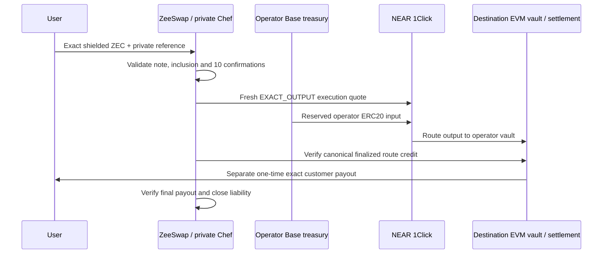

# NEAR EVM quote and capital policy

Specification v1, 23 October 2026. Proposed execution mode:
`evm-treasury-route-v1`, disabled until the [integration gates](README.md) pass.
The native TAZ/mockUSDC pair continues to use direct operator liquidity.

## Route boundary and both directions

NEAR Intents is an EVM inventory conversion/transport provider. It never receives
a native Zcash deposit, shielded address, viewing key, memo or Zcash refund
instruction. Provider input belongs to the operator; provider output and refunds
go to operator-controlled EVM vaults. ZeeSwap separately delivers the exact
customer output. No arbitrary calls, destinations encoded in URLs, native-asset
routes, fee-on-transfer/rebasing tokens, partial fills, FLEX_INPUT or ANY_INPUT
are enabled in this first provider mode.

Only a future explicitly approved EVM chain/standard ERC-20 pair can activate
these paths. A listed provider token does not automatically join our registry.
The following diagrams describe future roles, not a newly enabled chain.



For the reverse direction, the user first funds a ZeeSwap source escrow on the
approved EVM chain. Its principal remains segregated. Operator inventory on that
chain funds the provider, which returns the configured Base asset to ZeeSwap's
Base vault. This route credit must become final before this mode commits the
source escrow to the Zcash payout branch. Finalize that branch commitment, then
sign and deliver shielded ZEC locally. Release the user's escrow into operator
inventory only after Zcash receipt verification and settlement acknowledgement.

If source-chain cancellation wins before commitment, no Zcash payout is allowed;
a provider credit arriving later is treasury inventory. Routing before commitment
uses operator capital at operator risk. Routing is not required for direct
Base-to-Zcash orders: it is a future option for reaching another EVM chain.

The current settlement contract is testnet-only, has one configured six-decimal
token and no reverse abort from `PAYOUT_COMMITTED`. It cannot simply be deployed
on another production chain or used to label provider funding as `Paid`. New
chain deployments, reverse abort and asset support need reviewed contract/mode
work under I4. A provider transfer directly to the existing contract does not
call `fund`, create a customer escrow or authenticate an order.

## Two different quotes

| Layer | Purpose | Binding period |
| --- | --- | --- |
| Customer quote | ZeeSwap's exact source input, exact net output, recipients, refund conditions and capital promise. | Immutable after acceptance, including a timely deposit that confirms later. |
| Provider preview | Indicative route availability/cost with `dry: true`; no reserved execution or deposit address. | A short pricing input only. Never a promise to the customer by itself. |
| Provider execution quote | A fresh signed route with funding instructions, strict endpoints and finite expiry. | Used only for one journaled route attempt after source eligibility. |

Existing defaults are retained: acceptance within 120 seconds; Zcash funding
cutoff at acceptance canonical tip + 12 blocks; Base source funding cutoff at
acceptance time + 900 seconds, cancellation available 7,200 seconds after that
cutoff. Timeliness uses canonical inclusion, not discovery time. Ten Zcash
confirmations may complete after the funding cutoff. No quote refresh can make a
late deposit timely. Retain watchers for expired/retired deposit receivers.

The customer's agreement is **exact delivery or full source-principal refund
under the specified failure conditions**. It is not a promise of an unbounded
execution deadline or guaranteed market access. Source gas paid by the user is
not reimbursed. For a valid order, operator-paid refund fees must not reduce
principal. No user top-up, price change, new refund address or smaller output is
silently accepted after funding. A changed deal requires a separate new order
after the old obligation is resolved; it cannot hide the original liability.

## Immutable customer terms and internal reserves

Extend the existing private quote, in a new version, with these terms:

| Field | Constraint |
| --- | --- |
| `quoteVersion`, `executionMode`, `policyDigest` | Pin semantics, registry and finality policy. Existing orders keep their original versions. |
| `sourceAsset`, `destinationAsset` | Network/chain ID + token contract or native Zcash identity + decimals; never symbol-only. |
| `inputAtomic`, `netOutputAtomic` | Positive canonical integer strings. One primary deposit; exact amount. |
| `recipient`, `refundRecipient` | Validated, immutable, chain-specific; shielded-capable for native Zcash. No sender inference. |
| `acceptUntil`, `fundingCutoff`, `cancellationAvailableAt` | Explicit units and strict boundary comparison; preserve existing height/time rules. |
| `deliveryOrRefundPolicy` | Operator price-risk ownership, eligibility, bounded preparation, cancellation and ambiguity handling. |
| `feePolicy` | Net output is after all customer deductions. Protocol fee remains zero for the prototype; operator expenses are separate. |
| `nonce`, private/public identifiers | Domain-separated quote integrity; random reference is not an access credential. |

Keep these internal fields separately encrypted/bound by the accepted digest:
provider asset mapping, preview digest/time, `maxProviderInputAtomic`, input
asset, allowed provider identity, slippage bound, per-chain gas budgets, treasury
vaults and maximum outstanding provider exposure. Provider payloads must not
contain the Zcash order/reference or a public mapping to it.

## Capital and price-risk rule

At acceptance, reserve destination fulfillment capacity and fees as the existing
plan requires. For a future route, fulfillment capacity means either already
available destination inventory, or **earmarked operator source inventory up to
the maximum route input plus an explicit route-loss budget and all downstream
fees**. This extension is disabled until a capital review accepts it for that
specific route. Do not describe a dry provider quote as reserved liquidity.

Reserve the complete user source principal for return until delivery settles;
never spend it to fund the provider. For a Zcash source, the confirmed incoming
principal becomes a segregated refundable obligation, and safe refund fee/note
selection capacity must be available. For EVM source, escrow holds the principal
until final settlement. Reserve Zcash payout capacity separately for reverse
orders. Inventory reservations are exclusive claims, not duplicate accounting
assets. An earmarked provider input is not simultaneously available for another
payout, refund or route.

Per asset and vault:

```text
available = confirmed controlled balance
          - customer principal liabilities held there
          - other funded obligations / in-flight spends
          - exclusive operator reservations
          - fee and incident buffers

requiredProviderInput <= maxProviderInputAtomic
actual chain gas <= reserved chain gas cap
sum(unresolved provider principal exposure) <= configured funded exposure limit
```

The route input cap is calculated at acceptance from a validated preview cost
plus an explicitly configured risk allowance using ceiling integer arithmetic.
Neither provider slippage nor a new quote expands that cap. Initial disabled-mode
fixture settings: risk allowance 100 bps, provider slippage bound 50 bps, at most
one funded route attempt per order and one unresolved provider route globally.
These are test vectors/configuration candidates, not a mainnet risk approval.
The funded global loss budget must cover the entire input cap, not just 1%.
Existing overall unresolved-order limit remains five or lower due to reserves.

Example, using a fictional six-decimal EVM asset: preview input 9,900,000 units;
100-bps risk allowance gives a 9,999,000-unit cap. An executable request for
9,980,000 units fits; 10,010,000 does not. If the accepted customer output is
10,000,000 destination units, it stays 10,000,000. Drift, provider fees and gas
belong to the operator; a failed affordability check leads to bounded wait/refund,
never 9,900,000 silently delivered to the user. These are arithmetic fixtures,
not a ZEC/USD exchange-rate assertion.

## Provider request and validation contract

Use the official 1Click transport and pinned SDK/OpenAPI schema. The current
authentication guide supports partner JWT in `X-API-Key` and also accepts the
same JWT via `Authorization: Bearer`; use the first form consistently. This is
server-only authentication, not end-user wallet ownership. Do not fall back to
unauthenticated pricing on failure because that can change fees.

Map the route request as follows:

| Provider field | ZeeSwap value |
| --- | --- |
| `dry` | True for preview; false only for a prepared execution attempt. |
| `swapType` | `EXACT_OUTPUT`. |
| `amount` | Exact destination-vault net credit required to cover the later exact customer payout, in atomic units. |
| `originAsset`, `destinationAsset` | Pinned provider IDs mapped to independently verified EVM chains, ERC-20 contracts and decimals. |
| `depositType` | `ORIGIN_CHAIN`. |
| `recipientType` | `DESTINATION_CHAIN`. |
| `recipient` | Immutable operator-controlled destination vault, never the user in this mode. |
| `refundType`, `refundTo` | `ORIGIN_CHAIN`, operator-controlled origin refund vault. Never the Zcash refund address. |
| `slippageTolerance` | Configured basis points, at most the accepted bound; not extra capital authorization. |
| `deadline` | Finite execution funding horizon meeting the safety budget below. |
| `appFees` | Omitted in the first mode; provider fees still apply and must be budgeted. |

Do not enable confidential balance/session, signed-user-intent, yield, generic
calldata, insurance or alternative deposit modes implicitly. Reject an EVM quote
that unexpectedly requires a memo or unsupported deposit-call semantics; plain
ERC-20 transfers cannot reliably carry an arbitrary memo. Preserve the provider
deposit-address-plus-memo identity for diagnostic status reads when present, but
do not fund such a quote until a separate reviewed transport supports it.

Before using any deposit instruction:

1. Verify signature with the pinned official verifier and trusted signing-key
   policy; reject unsigned, invalid, stale or mutated responses. Verify status
   response quote payloads too where that format supports them. Signatures prove
   payload origin, not payment or future success.
2. Compare every security-relevant echoed field with the request: endpoints,
   assets, chain mapping, vaults, amount semantics, deadline, slippage and fees.
   Reject unknown mandatory fields or unrecognized protocol versions.
3. Require non-dry execution fields, valid unique deposit address, positive
   `amountIn`, supported time bounds and all relevant fee amounts. Parse atomic
   strings only. For EXACT_OUTPUT, fund the returned `amountIn`, not
   `minAmountIn`; the smaller field is not our authorized funding amount.
4. Require the quoted destination transfer to yield the full required vault
   credit after withdrawal charges. The live schema's `amountOut`, `withdrawFee`
   and final receipt behavior must establish this unambiguously. If net semantics
   cannot be verified, do not fund. Never subtract a fee twice or guess its asset.
5. Check input, fee/gas, aggregate exposure and safe time bounds against the
   reserved caps. Validate token code/decimals, configured vault control, chain
   identity and sufficient safe spendable capital before any signature request.
6. Persist encrypted payload, signature, canonical digest, provider operation
   locator, normalized terms and attempt ID before preparing a payment. An unused
   quote is not funding; a reused address across incompatible attempts blocks.

Treat SDK signature verification support and signer-key rotation as a pinned
dependency with test vectors; do not invent a signing key from a response.
Provider quote signatures are not wallet transaction authorizations. The EVM
signer only accepts the exact bounded transfer, token, destination, chain, nonce,
gas policy and operation digest that passed this contract.

Use fixed allowlisted provider and RPC endpoints. Treat response explorer links,
callbacks and URLs as untrusted data, never endpoints to fetch or execute.
Provider funding is an exact ERC-20 transfer; do not grant an unlimited allowance,
accept an arbitrary spender, or execute response-supplied calldata in this mode.

## Expiry and retry policy

Planning defaults below apply only to the new disabled mode. Preserve accepted
customer terms and existing direct settlement behavior.

| Timer/budget | Proposed default and action |
| --- | --- |
| Preview age at acceptance | At most 30 seconds from local receipt, valid signed provider timestamp and healthy provider; preview is still nonbinding. |
| Execution-quote age before signing | At most 30 seconds, with deadline safety also satisfied. An old quote is not refreshed by changing a local timestamp. |
| Deadline safety | Earlier of provider `deadline` and `timeWhenInactive`, less the configured funding lead budget. Initial lead budget 180 seconds, plus up to five seconds clock skew. Sign only if sufficient time remains for the intended canonical funding observation policy. |
| Unfunded preparation | At most three execution-quote generations within 15 minutes of source eligibility, backoff 5/15/30 seconds on retryable faults. Preserve exact terms; then enter cancellation/refund preparation. |
| Provider status poll | Every five seconds initially; after two minutes every 15 seconds; after ten minutes every 60 seconds. Honor longer `Retry-After`, bounded jitter and one in-flight request. |
| Funded route taking 30 minutes | Stop further attempts, reconcile original funding/output and request customer-branch cancellation if the refund guards can be proved. |
| Two hours unresolved | Operator incident/escalation, persistent liabilities and capital holds; never an automatic financial write-off or refund permission. |

The lead budget is a candidate, not evidence that 180 seconds covers every
chain/finality policy. Each enabled route must measure funding inclusion/finality
and configure a sufficient horizon. If finalized funding before inactivity is
not feasible, request a longer valid quote or refuse that route. Never weaken
Base finality to fit a provider deadline. Provider estimates are display inputs,
not finality evidence or contractual completion times.

If a quote expires before any funding signature, abandon that attempt and obtain
a new quote within preparation limits. If a funding signature exists, reconcile
it first: provider quote expiry does not expire an ordinary EVM transaction.
A signed late transfer may still land and trigger provider/manual recovery.
No second funded route is allowed for that order in v1, even after a refund;
the default recovery is customer source refund, not another spend.

If a non-dry quote request times out before receiving a response, persist the
request digest as an uncertain unused quote. A later new quote is permissible
only when no funding intent/signature could have been created for that missing
response; no transport-level retry is allowed to invoke a signer implicitly.
Persist every issued locator and watch any address that was actually funded.

## External activation gaps

Official FAQ currently states no testnet deployment. mockUSDC and TAZ cannot be
treated as supported 1Click assets. Local fixtures and read-only previews do not
prove provider settlement. Live activation requires a separate production asset
registry and explicit chain/asset/amount/fee-inclusive authorization, independent
of this design and of older testnet deployer permission.

Before I6, verify actual schema/signature compatibility, exact net withdrawal and
refund fee semantics, vault-recipient support, token minima/liquidity, partner
credentials, provider availability/terms and restricted-token screening behavior.
A compliance or manual hold maps to reconciliation, never guaranteed instant
refund. These are external acceptance facts; financial policy in this document
does not assume they have passed.

## Acceptance scenarios

| ID | Scenario | Required result |
| --- | --- | --- |
| Q01 | Source takes longer than the preview's lifetime | Exact customer terms retained; fresh execution quote only after eligibility. |
| Q02 | Quote accepted before cutoff; timely note discovered late | Judge inclusion height; no false late classification. |
| Q03 | Fresh route input exceeds reserved cap | No signature; bounded wait then source-refund path. |
| Q04 | Provider output/withdrawal net semantics ambiguous | Refuse funding; no guessed net output. |
| Q05 | EXACT_OUTPUT response has smaller `minAmountIn` | Send only the authorized `amountIn` if within cap; never substitute the smaller value. |
| Q06 | Endpoint is Zcash, wrong contract or unsupported EVM chain | Reject before showing/funding executable instructions. |
| Q07 | Response signature invalid or destination changed | Reject, retain audit digest and stop affected provider mode. |
| Q08 | Signed funding exists and quote expires | Reconcile original nonce/raw transaction; no new funded attempt. |
| Q09 | Customer cancels reverse escrow while treasury route is pending | Do not sign Zcash payout; later provider credit belongs to treasury. |
| Q10 | Two accepts compete for the same route capital | Atomic reservation permits only funded capacity; loser receives no accepted quote. |
| Q11 | Fee schedule changes or API auth fails | Refuse new acceptance/execution; no anonymous fallback. |
| Q12 | Provider route succeeds | Still require final treasury receipt and separate customer settlement proof. |

See [route recovery](evm-route-recovery.md) for allowed actions after each provider
status and the exact treatment of returned USDC. Upstream source links are
collected in the [integration index](README.md#review-and-sources).
