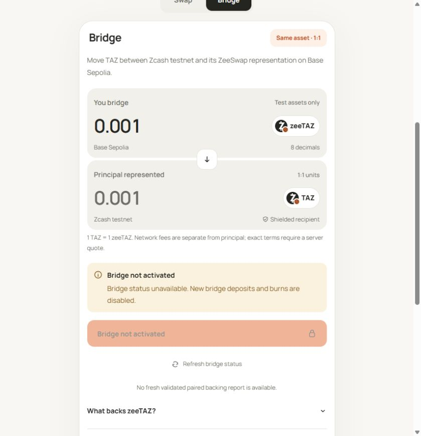

# Bridge interface published; financial activation remains closed

On 26 October 2026, Root published the reviewed static web build to
https://zeeswap.endpx.cloud/. The live browser verified the Swap/Bridge controls,
both TAZ-to-zeeTAZ and zeeTAZ-to-shielded-TAZ displays, eight-decimal 1:1 principal,
and the disabled **Bridge not activated** action. No quote, deposit, burn,
transaction signature or wallet request was performed in this browser check.

This screenshot is from the actual HTTPS site, not the synthetic browser suite.
It contains no private order, wallet address, memo or access capability. The
interface exposes no fabricated backing report when its source is unavailable.

## Deployment and source checks

The production build used VITE_API_BASE_URL=https://zeeswap.endpx.cloud and passed
TypeScript/build checks. Root verified all 15 emitted public files (2,539,875
bytes), rejected symlinks and checked the bundle for the intended public origin
and checked credential patterns. This is a scoped publication check, not a
comprehensive security audit.

- Public archive SHA256: 135e5bfbd24ca53c1f3b6d0b0a164ffb4ce2d059d0f8ac7f73debb6c84d8e12e.
- Emitted index SHA256: 56e6e98418b8d19deb707b7b4d5af6af091a7093d3f9ddceb9bed1da1ec35099.
- Main JS SHA256: 19016efd357c242927fc921a90fca4d24e08fe4f361fb400cce0c0fb3474ed7b.
- Original public assets were retained for existing clients. Nginx configuration
  validation and graceful reload passed after the static-root switch. An exact
  /availability read-only proxy was added for the existing API endpoint.
- API PID remained 1850754 throughout; no application observer, worker, database
  migration, control epoch, financial policy or signer was changed by deployment.
- HTTPS /health returned status ok/integrationOnly false. /availability returned
  disabled with policy null at 09:54:47 UTC. Connectivity is not trade readiness.
- Existing API startup still omits the bridge runtime. No public bridge mint,
  burn or shielded delivery is claimed. Code publication and live activation
  remain separate.

## Actual Linux journal verification

Root separately copied only the four public test/source inputs into an isolated
private fixture directory on the VPS and ran Node 24 with the installed TSX loader.
All three journal tests passed, zero skipped, in 0.283 seconds. They exercised
partial-I/O completion and zero-progress refusal, encrypted original-byte recovery,
persisted broadcast UNKNOWN with no second network callback, and an interrupted
signing marker with no automatic re-signing. Native file/directory fsync and private
Linux directory/file modes were exercised. No Docker, PostgreSQL connection,
wallet, native SDK or actual financial transaction was used by these three cases.

These three cases overlap the local journal suite; do not add them to that suite
as unique tests. See [bridge implementation evidence](g6-bridge-implementation.md)
for separate contract, model, synthetic UI and actual PostgreSQL results. G6's
live acceptance remains open.
