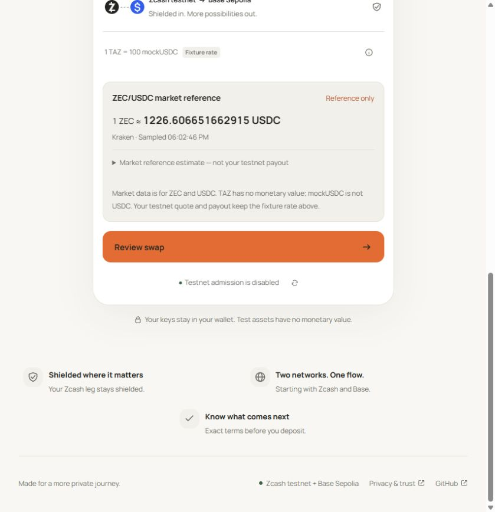

# Actual public market-reference deployment — 26 October 2026

The user chose real market data as a display-only reference. Root deployed the
separate read-only service and static web build, then verified actual Kraken data
through the public HTTPS endpoint and the user's browser. Existing testnet quote
and payout arithmetic, accepted terms, inventory policy, and bridge 1:1 principal
were not changed. No wallet request, quote acceptance, transaction or financial
activation was performed during browser verification.

The screenshot is from https://zeeswap.endpx.cloud/, not the mocked browser
suite. It shows a sampled ZEC/USDC reference from Kraken, the separate fixture
rate, the test-asset disclaimer and disabled testnet admission. No private order,
recipient, capability or memo is present.

## Operator checks

- Root's corrected actual Linux suite passed **16/16, zero skips**, in 0.725
  seconds. The earlier 15-pass/1-fail scheduling race and the test-only correction
  remain recorded in [preparation evidence](market-reference.md). All four
  production modules retained their reviewed hashes.
- The public systemd unit passed native validation. It runs an independent Node
  process under a dynamic unprivileged user with normal TLS, a 24 MiB V8 heap,
  MemoryHigh 80 MiB, MemoryMax 96 MiB and no access to the application directory.
  It imports no database, wallet, signer or transaction module.
- The service started at **17:57 WIB (10:57 UTC)** with PID 2612027. Actual normal-
  TLS source sampling and cache responses were available after startup. Later
  readback retained that PID with zero restarts and cgroup MemoryCurrent
  22,749,184 bytes / MemoryPeak 23,445,504 bytes. This is bounded observation,
  not a long-duration availability or capacity claim; cgroup accounting differs
  from the earlier standalone process RSS measurement.
- An initial probe reached the process before its listener bound; the subsequent
  read confirmed availability without a service restart. An immediate post-Nginx-
  reload request also reached the retiring SPA worker. Only later fresh index-
  hash and JSON reads count as public handoff verification.
- Actual HTTPS GET returned 200 application/json with no-store; HEAD returned
  200 and no body. POST returned 405, and an arbitrary pair query returned 404.
  The source sampler is shared: browser reads do not trigger new provider calls.
- The production frontend was built with the exact public API origin. Root
  verified all 15 emitted files (2,546,801 bytes), rejecting symlinks and checked
  credential patterns. Existing static assets were retained for older clients.
- Nginx configuration validation and graceful reload passed. Only the static root
  and exact /market-reference proxy were added/changed. The financial API retained
  PID 1850754. Its /availability returned disabled with policy null at
  **18:03 WIB (11:03 UTC)**; no financial service was restarted or enabled.
- Actual browser reads showed successive sampled times 15 seconds apart and
  current derived rates. The input's reference comparison worked in both
  directions; the fixture outputs remained 0.01 TAZ to 1 mockUSDC and 1 mockUSDC
  to 0.01 TAZ. No acceptance or funding control was invoked.

## Artifact identities

| Artifact | SHA-256 |
| --- | --- |
| Eight-file service package, revision 2 | 4d21c379e570a9f4b86cea3202d80b9630972b5b1214c870e58a7bfd1b448777 |
| Static web archive | c0922dc637c0d5e37264c523209b5bafdee6b1dbb1b9fc22199149a0e364c79c |
| Public index.html | 344024424857f04ecc3b8e0e364f7a046c35c700e44079455634cd89f84acebe |
| Main JS index-Df4U3son.js | bd89a48e9eaf90a3aa2c022cf4d33e530f7fb07b9ce5690df57a1127bd60fd83 |
| Installed systemd unit | 4c56423042daeba1b8aba8cd77d841500e77d325a9725dc0d63a078b567f86fc |

The provider remains an exchange-data dependency, not an executable quote or an
on-chain oracle. The ticker price update time is not supplied by this integration:
exchangeUpdatedAt is null, and the UI says Sampled. Unavailable/expired data is
withheld. TAZ and mockUSDC remain valueless test assets, and this feature does not
close the separate funded swap/bridge acceptance gates.
